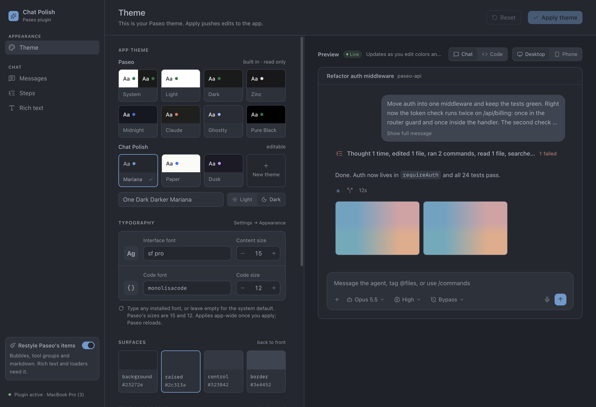
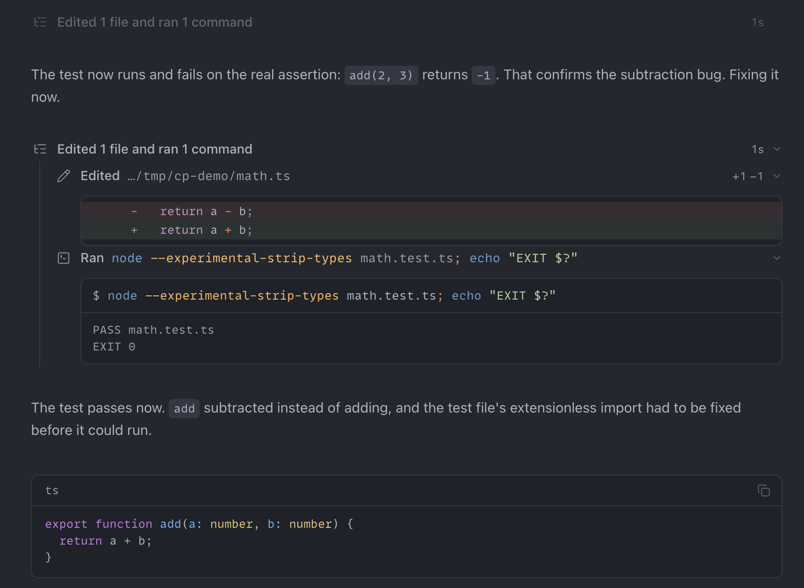
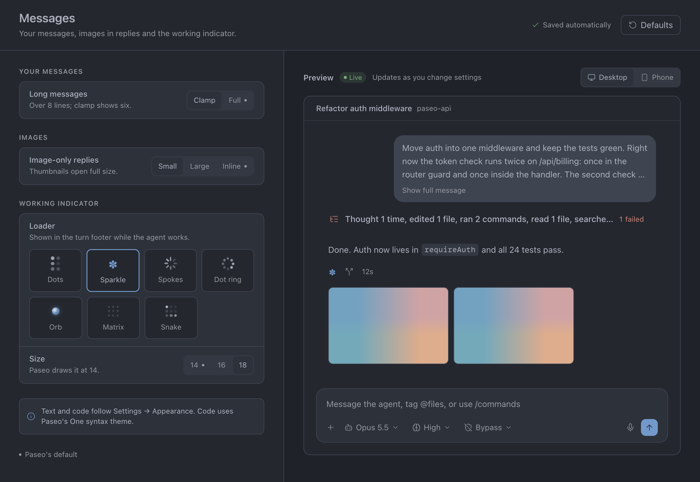
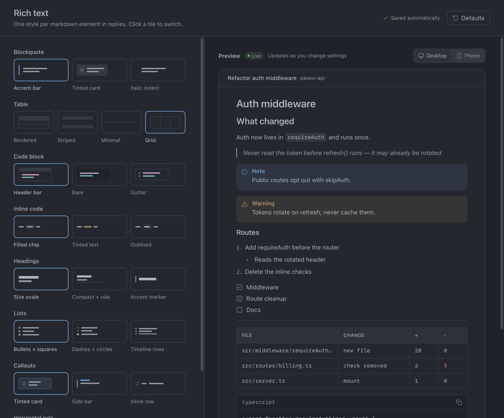
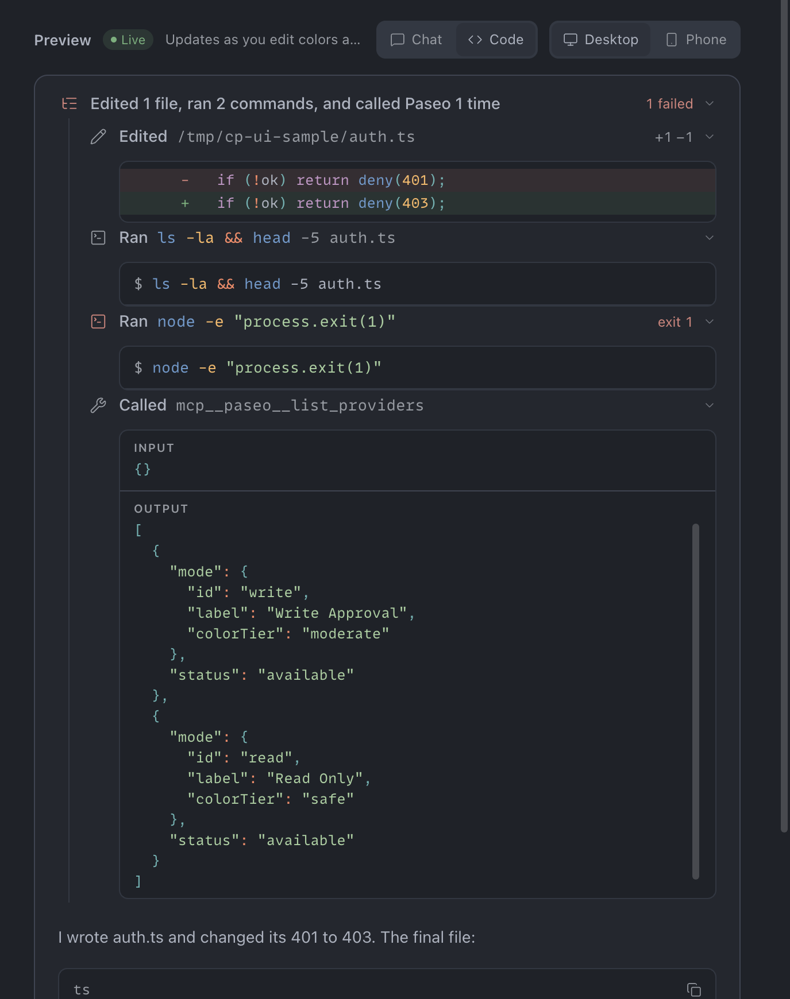

# Chat Polish

A [Paseo](https://paseo.sh) plugin that redraws the agent chat as one quiet column, adds the One Dark Darker Mariana theme, and gives you a dashboard to tune it all with a live preview.



## What it does

- **Tool calls as single rows.** An icon, a verb that shows the state (Running, Ran), the command or file, and a short detail. Open a row for its diff, output or raw input and output. Failed calls turn red.
- **Steps merged between replies.** The thoughts and tool calls before an answer fold into one row, such as "Edited 1 file and ran 1 command", which opens to each step.
- **Themes.** Pick one of Paseo's built-in themes or a Chat Polish one (Mariana, Paper, Dusk), or edit the colors with contrast checks. Fonts and sizes are set from the same page.
- **Rich text styles.** Three or four looks each for quotes, tables, code blocks, inline code, headings, lists, callouts and rules.
- **Working indicator.** Paseo's dots, or a sparkle, spokes, dot ring, orb, matrix or snake loader.
- **Extras.** Turn recaps, ⌥⌘↑/↓ to jump between your prompts, and Command Center (⌘K) toggles.



## Dashboard

Open **Chat Polish** in the sidebar. Every page has a live preview, and changes save as you pick.

| Messages | Rich text |
| --- | --- |
|  |  |

The Theme page previews code too. The Code tab draws the same rows the chat uses:



## Install

Requires Paseo 0.11.2 or later.

```sh
paseo plugin install https://github.com/lthieu96/paseo-chat-polish
```

Restyling Paseo's own items, fonts and the app theme picker work on desktop and web.

## Develop

```sh
npm install
npm run typecheck
npm test
paseo plugin install .              # once, from this directory
paseo plugin reload paseo-chat-polish
```

Designs live in `design/dashboard.pen` (open it with [pen.dev](https://pen.dev)).
